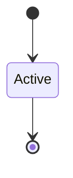
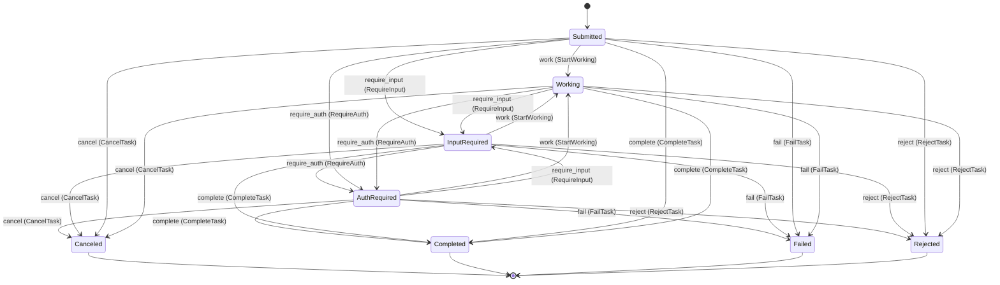

<!--
generated from a2a v1
model digest 911794dff39b27311ddc6db22aa294d7c70c823fd2310684ad996b6eab4c5cdf
contract digest slice-sha256/2:2af66dcfe0f70ad1a2ee938e58a3af722c41ea672b67051d17c1993b1bdf54a7
do not edit: regenerate with `ess generate`
-->

# Discovery

The Agent Card an A2A agent publishes about itself: identity, interfaces, capabilities, skills and security schemes (A2A v1.0.1 section 4.4, proto messages AgentCard and below).

`a2a.discovery` is one of a2a's bounded contexts. [Back to the index](../index.md).

## Types

### `APIKeySecurityScheme`

`a2a.discovery.APIKeySecurityScheme` is a record of three fields:

- `description` — `Optional<String>`, which may be absent
- `location` — `String`
- `name` — `String`

### `AgentCapabilities`

`a2a.discovery.AgentCapabilities` is a record of four fields:

- `streaming` — `Optional<Boolean>`, which may be absent
- `push_notifications` — `Optional<Boolean>`, which may be absent, called `pushNotifications` on the wire
- `extensions` — `Optional<List<a2a.discovery.AgentExtension>>`, which may be absent
- `extended_agent_card` — `Optional<Boolean>`, which may be absent, called `extendedAgentCard` on the wire

### `AgentCard`

`a2a.discovery.AgentCard` is a record of 14 fields:

- `name` — `String`
- `description` — `String`
- `supported_interfaces` — `List<a2a.discovery.AgentInterface>`, called `supportedInterfaces` on the wire
- `provider` — `Optional<a2a.discovery.AgentProvider>`, which may be absent
- `version` — `String`
- `documentation_url` — `Optional<String>`, which may be absent, called `documentationUrl` on the wire
- `capabilities` — `a2a.discovery.AgentCapabilities`
- `security_schemes` — `Optional<Map<String, a2a.discovery.SecurityScheme>>`, which may be absent, called `securitySchemes` on the wire
- `security_requirements` — `Optional<List<a2a.discovery.SecurityRequirement>>`, which may be absent, called `securityRequirements` on the wire
- `default_input_modes` — `List<String>`, called `defaultInputModes` on the wire
- `default_output_modes` — `List<String>`, called `defaultOutputModes` on the wire
- `skills` — `List<a2a.discovery.AgentSkill>`
- `signatures` — `Optional<List<a2a.discovery.AgentCardSignature>>`, which may be absent
- `icon_url` — `Optional<String>`, which may be absent, called `iconUrl` on the wire

### `AgentCardSignature`

`a2a.discovery.AgentCardSignature` is a record of three fields:

- `protected` — `String`
- `signature` — `String`
- `header` — `Optional<Json>`, which may be absent

### `AgentExtension`

`a2a.discovery.AgentExtension` is a record of four fields:

- `uri` — `Optional<String>`, which may be absent
- `description` — `Optional<String>`, which may be absent
- `required` — `Optional<Boolean>`, which may be absent
- `params` — `Optional<Json>`, which may be absent

### `AgentInterface`

`a2a.discovery.AgentInterface` is a record of four fields:

- `url` — `String`
- `protocol_binding` — `String`, called `protocolBinding` on the wire
- `tenant` — `Optional<String>`, which may be absent
- `protocol_version` — `String`, called `protocolVersion` on the wire

### `AgentProvider`

`a2a.discovery.AgentProvider` is a record of two fields:

- `url` — `String`
- `organization` — `String`

### `AgentSkill`

`a2a.discovery.AgentSkill` is a record of eight fields:

- `id` — `String`
- `name` — `String`
- `description` — `String`
- `tags` — `List<String>`
- `examples` — `Optional<List<String>>`, which may be absent
- `input_modes` — `Optional<List<String>>`, which may be absent, called `inputModes` on the wire
- `output_modes` — `Optional<List<String>>`, which may be absent, called `outputModes` on the wire
- `security_requirements` — `Optional<List<a2a.discovery.SecurityRequirement>>`, which may be absent, called `securityRequirements` on the wire

### `AuthorizationCodeOAuthFlow`

`a2a.discovery.AuthorizationCodeOAuthFlow` is a record of five fields:

- `authorization_url` — `String`, called `authorizationUrl` on the wire
- `token_url` — `String`, called `tokenUrl` on the wire
- `refresh_url` — `Optional<String>`, which may be absent, called `refreshUrl` on the wire
- `scopes` — `Map<String, String>`
- `pkce_required` — `Optional<Boolean>`, which may be absent, called `pkceRequired` on the wire

### `ClientCredentialsOAuthFlow`

`a2a.discovery.ClientCredentialsOAuthFlow` is a record of three fields:

- `token_url` — `String`, called `tokenUrl` on the wire
- `refresh_url` — `Optional<String>`, which may be absent, called `refreshUrl` on the wire
- `scopes` — `Map<String, String>`

### `DeviceCodeOAuthFlow`

`a2a.discovery.DeviceCodeOAuthFlow` is a record of four fields:

- `device_authorization_url` — `String`, called `deviceAuthorizationUrl` on the wire
- `token_url` — `String`, called `tokenUrl` on the wire
- `refresh_url` — `Optional<String>`, which may be absent, called `refreshUrl` on the wire
- `scopes` — `Map<String, String>`

### `HTTPAuthSecurityScheme`

`a2a.discovery.HTTPAuthSecurityScheme` is a record of three fields:

- `description` — `Optional<String>`, which may be absent
- `scheme` — `String`
- `bearer_format` — `Optional<String>`, which may be absent, called `bearerFormat` on the wire

### `ImplicitOAuthFlow`

`a2a.discovery.ImplicitOAuthFlow` is a record of three fields:

- `authorization_url` — `Optional<String>`, which may be absent, called `authorizationUrl` on the wire
- `refresh_url` — `Optional<String>`, which may be absent, called `refreshUrl` on the wire
- `scopes` — `Optional<Map<String, String>>`, which may be absent

### `MutualTlsSecurityScheme`

`a2a.discovery.MutualTlsSecurityScheme` is a record of one field:

- `description` — `Optional<String>`, which may be absent

### `OAuth2SecurityScheme`

`a2a.discovery.OAuth2SecurityScheme` is a record of three fields:

- `description` — `Optional<String>`, which may be absent
- `flows` — `a2a.discovery.OAuthFlows`
- `oauth2_metadata_url` — `Optional<String>`, which may be absent, called `oauth2MetadataUrl` on the wire

### `OAuthFlows`

`a2a.discovery.OAuthFlows` is a record of five fields:

- `authorization_code` — `Optional<a2a.discovery.AuthorizationCodeOAuthFlow>`, which may be absent, called `authorizationCode` on the wire
- `client_credentials` — `Optional<a2a.discovery.ClientCredentialsOAuthFlow>`, which may be absent, called `clientCredentials` on the wire
- `implicit` — `Optional<a2a.discovery.ImplicitOAuthFlow>`, which may be absent
- `password` — `Optional<a2a.discovery.PasswordOAuthFlow>`, which may be absent
- `device_code` — `Optional<a2a.discovery.DeviceCodeOAuthFlow>`, which may be absent, called `deviceCode` on the wire

### `OpenIdConnectSecurityScheme`

`a2a.discovery.OpenIdConnectSecurityScheme` is a record of two fields:

- `description` — `Optional<String>`, which may be absent
- `open_id_connect_url` — `String`, called `openIdConnectUrl` on the wire

### `PasswordOAuthFlow`

`a2a.discovery.PasswordOAuthFlow` is a record of three fields:

- `token_url` — `Optional<String>`, which may be absent, called `tokenUrl` on the wire
- `refresh_url` — `Optional<String>`, which may be absent, called `refreshUrl` on the wire
- `scopes` — `Optional<Map<String, String>>`, which may be absent

### `SecurityRequirement`

`a2a.discovery.SecurityRequirement` is a record of one field:

- `schemes` — `Map<String, a2a.discovery.StringList>`

### `SecurityScheme`

`a2a.discovery.SecurityScheme` is a record of five fields:

- `api_key_security_scheme` — `Optional<a2a.discovery.APIKeySecurityScheme>`, which may be absent, called `apiKeySecurityScheme` on the wire
- `http_auth_security_scheme` — `Optional<a2a.discovery.HTTPAuthSecurityScheme>`, which may be absent, called `httpAuthSecurityScheme` on the wire
- `oauth2_security_scheme` — `Optional<a2a.discovery.OAuth2SecurityScheme>`, which may be absent, called `oauth2SecurityScheme` on the wire
- `open_id_connect_security_scheme` — `Optional<a2a.discovery.OpenIdConnectSecurityScheme>`, which may be absent, called `openIdConnectSecurityScheme` on the wire
- `mtls_security_scheme` — `Optional<a2a.discovery.MutualTlsSecurityScheme>`, which may be absent, called `mtlsSecurityScheme` on the wire

### `StringList`

`a2a.discovery.StringList` is a record of one field:

- `list` — `List<String>`

One of the types above is reached by nothing else in this system: `a2a.discovery.AgentCard`. No entity, view, command, event, error or crossing names it, so it is either vocabulary something outside this specification uses or a leftover — and only a person can tell which.

## Commands

### `GetExtendedAgentCard`

`a2a.discovery.GetExtendedAgentCard`, shown to a person as "Get extended agent card" and called `extendedAgentCard` on the wire.

It takes:

- `tenant` — `Optional<String>`, which may be absent

It has five outcomes.

**`not-supported`** — Decided outside the input: the public agent card does not declare capabilities.extendedAgentCard. No predicate over the input reaches this branch, and saying `when: false` instead would have claimed it is unreachable, which is a different and false statement. No entity in this specification changes. It reports `a2a.discovery.UnsupportedOperation`. It emits nothing. A test reaches it by injecting the declared fault, because no input can.

**`not-configured`** — Decided outside the input: the agent declares the capability but has no extended card configured. No predicate over the input reaches this branch, and saying `when: false` instead would have claimed it is unreachable, which is a different and false statement. No entity in this specification changes. It reports `a2a.discovery.ExtendedAgentCardNotConfigured`. It emits nothing. A test reaches it by injecting the declared fault, because no input can.

**`returned`** — The extended Agent Card. The default branch, taken when no other outcome's condition matched. No entity in this specification changes. It emits nothing. A test reaches it by constructing an input that satisfies no other outcome's condition.

**`version-not-supported`** — Decided outside the input: the A2A-Version service parameter names a version the agent does not support. No predicate over the input reaches this branch, and saying `when: false` instead would have claimed it is unreachable, which is a different and false statement. No entity in this specification changes. It reports `a2a.discovery.VersionNotSupported`. It emits nothing. A test reaches it by injecting the declared fault, because no input can.

**`extension-required`** — Decided outside the input: the agent card marks an extension required and the request does not declare it. No predicate over the input reaches this branch, and saying `when: false` instead would have claimed it is unreachable, which is a different and false statement. No entity in this specification changes. It reports `a2a.discovery.ExtensionSupportRequired`. It emits nothing. A test reaches it by injecting the declared fault, because no input can.

## Errors

### `ExtendedAgentCardNotConfigured`

ExtendedAgentCardNotConfiguredError (JSON-RPC -32007, gRPC FAILED_PRECONDITION, HTTP 400): the agent declares the capability but has no extended card configured.

It carries nothing beyond its name, so a caller can tell what went wrong and not which value caused it.

Reported by `a2a.discovery.GetExtendedAgentCard` on its `not-configured` outcome.

### `ExtensionSupportRequired`

ExtensionSupportRequiredError (JSON-RPC -32008, gRPC FAILED_PRECONDITION, HTTP 400): the agent card marks an extension required and the request does not declare it.

It carries nothing beyond its name, so a caller can tell what went wrong and not which value caused it.

Reported by `a2a.discovery.GetExtendedAgentCard` on its `extension-required` outcome.

### `UnsupportedOperation`

UnsupportedOperationError (JSON-RPC -32004, gRPC FAILED_PRECONDITION, HTTP 400): the agent card does not declare capabilities.extendedAgentCard.

It carries nothing beyond its name, so a caller can tell what went wrong and not which value caused it.

Reported by `a2a.discovery.GetExtendedAgentCard` on its `not-supported` outcome.

### `VersionNotSupported`

VersionNotSupportedError (JSON-RPC -32009, gRPC FAILED_PRECONDITION, HTTP 400): the A2A-Version the request names is not supported by the agent.

It carries nothing beyond its name, so a caller can tell what went wrong and not which value caused it.

Reported by `a2a.discovery.GetExtendedAgentCard` on its `version-not-supported` outcome.

## Actors

An actor is who may ask this context for something. Every grant below points at a command this specification declares — a grant is a resolved reference, so "may invoke" something nobody wrote is not a permission this model can express, and an authorisation that authorises nothing cannot ship quietly.

### `Client`

`a2a.discovery.Client`, shown to a person as "A2A client".

It may invoke [`GetExtendedAgentCard`](#getextendedagentcard).

---

Generated from a2a v1 · model digest `911794dff39b27311ddc6db22aa294d7c70c823fd2310684ad996b6eab4c5cdf` · contract digest `slice-sha256/2:2af66dcfe0f70ad1a2ee938e58a3af722c41ea672b67051d17c1993b1bdf54a7`. Do not edit this file; change the specification and regenerate it with `ess generate`.

<!--
generated from a2a v1
model digest 911794dff39b27311ddc6db22aa294d7c70c823fd2310684ad996b6eab4c5cdf
contract digest slice-sha256/2:e75c15344aac28adebe9e6d19f9a513c24c4017ccdf319d747fa838e7a169f88
do not edit: regenerate with `ess generate`
-->

# Tasks

Tasks an A2A agent runs for its clients, the messages and artifacts they carry, and the push-notification configurations that follow them (A2A v1.0.1 sections 3 and 4.1-4.3, proto service A2AService).

`a2a.tasks` is one of a2a's bounded contexts. [Back to the index](../index.md).

## Types

### `Artifact`

`a2a.tasks.Artifact` is a record of six fields:

- `artifact_id` — `String`, called `artifactId` on the wire
- `name` — `Optional<String>`, which may be absent
- `description` — `Optional<String>`, which may be absent
- `parts` — `List<a2a.tasks.Part>`
- `metadata` — `Optional<Json>`, which may be absent
- `extensions` — `Optional<List<String>>`, which may be absent

### `AuthenticationInfo`

`a2a.tasks.AuthenticationInfo` is a record of two fields:

- `scheme` — `String`
- `credentials` — `Optional<String>`, which may be absent

### `ContextId`

`a2a.tasks.ContextId` wraps `String` and is not interchangeable with one: the whole value of naming it separately is the crossings the model then refuses.

### `Message`

`a2a.tasks.Message` is a record of eight fields:

- `message_id` — `String`, called `messageId` on the wire
- `context_id` — `Optional<a2a.tasks.ContextId>`, which may be absent, called `contextId` on the wire
- `task_id` — `Optional<a2a.tasks.TaskId>`, which may be absent, called `taskId` on the wire
- `role` — `a2a.tasks.Role`
- `parts` — `List<a2a.tasks.Part>`
- `metadata` — `Optional<Json>`, which may be absent
- `extensions` — `Optional<List<String>>`, which may be absent
- `reference_task_ids` — `Optional<List<a2a.tasks.TaskId>>`, which may be absent, called `referenceTaskIds` on the wire

### `Part`

`a2a.tasks.Part` is a record of seven fields:

- `text` — `Optional<String>`, which may be absent
- `raw` — `Optional<Bytes>`, which may be absent
- `url` — `Optional<String>`, which may be absent
- `data` — `Optional<Json>`, which may be absent
- `metadata` — `Optional<Json>`, which may be absent
- `filename` — `Optional<String>`, which may be absent
- `media_type` — `Optional<String>`, which may be absent, called `mediaType` on the wire

### `PushNotificationConfigId`

`a2a.tasks.PushNotificationConfigId` wraps `String` and is not interchangeable with one: the whole value of naming it separately is the crossings the model then refuses.

### `PushNotificationConfigRow`

`a2a.tasks.PushNotificationConfigRow` wraps `String` and is not interchangeable with one: the whole value of naming it separately is the crossings the model then refuses.

### `Role`

`a2a.tasks.Role` is one of `ROLE_USER` and `ROLE_AGENT`.

### `SendMessageConfiguration`

`a2a.tasks.SendMessageConfiguration` is a record of four fields:

- `accepted_output_modes` — `Optional<List<String>>`, which may be absent, called `acceptedOutputModes` on the wire
- `task_push_notification_config` — `Optional<a2a.tasks.TaskPushNotificationConfig>`, which may be absent, called `taskPushNotificationConfig` on the wire
- `history_length` — `Optional<Integer>`, which may be absent, called `historyLength` on the wire
- `return_immediately` — `Optional<Boolean>`, which may be absent, called `returnImmediately` on the wire

### `TaskArtifactUpdateEvent`

`a2a.tasks.TaskArtifactUpdateEvent` is a record of six fields:

- `task_id` — `a2a.tasks.TaskId`, called `taskId` on the wire
- `context_id` — `a2a.tasks.ContextId`, called `contextId` on the wire
- `artifact` — `a2a.tasks.Artifact`
- `append` — `Optional<Boolean>`, which may be absent
- `last_chunk` — `Optional<Boolean>`, which may be absent, called `lastChunk` on the wire
- `metadata` — `Optional<Json>`, which may be absent

### `TaskId`

`a2a.tasks.TaskId` wraps `String` and is not interchangeable with one: the whole value of naming it separately is the crossings the model then refuses.

### `TaskPushNotificationConfig`

`a2a.tasks.TaskPushNotificationConfig` is a record of six fields:

- `tenant` — `Optional<String>`, which may be absent
- `id` — `Optional<a2a.tasks.PushNotificationConfigId>`, which may be absent
- `task_id` — `Optional<a2a.tasks.TaskId>`, which may be absent, called `taskId` on the wire
- `url` — `String`
- `token` — `Optional<String>`, which may be absent
- `authentication` — `Optional<a2a.tasks.AuthenticationInfo>`, which may be absent

### `TaskSnapshot`

`a2a.tasks.TaskSnapshot` is a record of six fields:

- `id` — `a2a.tasks.TaskId`
- `context_id` — `Optional<a2a.tasks.ContextId>`, which may be absent, called `contextId` on the wire
- `status` — `a2a.tasks.TaskStatus`
- `artifacts` — `Optional<List<a2a.tasks.Artifact>>`, which may be absent
- `history` — `Optional<List<a2a.tasks.Message>>`, which may be absent
- `metadata` — `Optional<Json>`, which may be absent

### `TaskState`

`a2a.tasks.TaskState` is one of `TASK_STATE_SUBMITTED`, `TASK_STATE_WORKING`, `TASK_STATE_COMPLETED`, `TASK_STATE_FAILED`, `TASK_STATE_CANCELED`, `TASK_STATE_INPUT_REQUIRED`, `TASK_STATE_REJECTED` and `TASK_STATE_AUTH_REQUIRED`.

### `TaskStatus`

`a2a.tasks.TaskStatus` is a record of three fields:

- `state` — `a2a.tasks.TaskState`
- `message` — `Optional<a2a.tasks.Message>`, which may be absent
- `timestamp` — `Optional<Timestamp>`, which may be absent

### `TaskStatusUpdateEvent`

`a2a.tasks.TaskStatusUpdateEvent` is a record of four fields:

- `task_id` — `a2a.tasks.TaskId`, called `taskId` on the wire
- `context_id` — `a2a.tasks.ContextId`, called `contextId` on the wire
- `status` — `a2a.tasks.TaskStatus`
- `metadata` — `Optional<Json>`, which may be absent

## Entities

An entity is what this context is about: something with an identity that outlives any one request, a shape, and a lifecycle. The lifecycle is exhaustive — a move that is not drawn below is a move this specification does not permit, and that is the only way it says so. Every move is labelled with the command that takes it, because a move nothing can trigger is refused rather than drawn.

### `PushNotificationConfig`

`a2a.tasks.PushNotificationConfig`.

An instance is identified by `row`, a `a2a.tasks.PushNotificationConfigRow`. The name is part of the model and not a convention: a view projects the identity under that name, so a projection inventing its own would disagree with the view.

It holds:

- `config_id` — `a2a.tasks.PushNotificationConfigId`
- `task_id` — `a2a.tasks.TaskId`
- `tenant` — `Optional<String>`, which may be absent
- `url` — `String`
- `token` — `Optional<String>`, which may be absent
- `authentication` — `Optional<a2a.tasks.AuthenticationInfo>`, which may be absent

Its `task_id` is what [`Task`](#task) owns it by, as `push_notification_configs`.

No invariant is declared, so nothing here constrains an instance at rest.

Its state is a `a2a.tasks.PushNotificationConfig.State`, one of `Active`. That enum is synthesised from the lifecycle rather than declared beside it, so the states a view's filter compares and the states drawn below cannot disagree.

An instance is created in `Active`. `Active` is terminal, so an instance may rest there forever. That is declared rather than inferred from having no way out: an entity that cannot leave a state is either finished or stuck, and only its author knows which.

It declares no moves, so nothing changes its state once it exists.

It has one state, so there is no move to permit or to forbid.

Two views project it: [`PushNotificationConfigs`](#pushnotificationconfigs) and [`TaskPushNotificationConfigs`](#taskpushnotificationconfigs).

### `Task`

`a2a.tasks.Task`.

An instance is identified by `id`, a `a2a.tasks.TaskId`. The name is part of the model and not a convention: a view projects the identity under that name, so a projection inventing its own would disagree with the view.

It holds:

- `context_id` — `a2a.tasks.ContextId`
- `tenant` — `Optional<String>`, which may be absent
- `status_message` — `Optional<a2a.tasks.Message>`, which may be absent
- `status_timestamp` — `Optional<Timestamp>`, which may be absent
- `artifacts` — `Optional<List<a2a.tasks.Artifact>>`, which may be absent
- `history` — `Optional<List<a2a.tasks.Message>>`, which may be absent
- `metadata` — `Optional<Json>`, which may be absent

It owns any number of [`PushNotificationConfig`](#pushnotificationconfig), as `push_notification_configs`, carried by `PushNotificationConfig.task_id`.

No invariant is declared, so nothing here constrains an instance at rest.

Its state is a `a2a.tasks.Task.State`, one of `AuthRequired`, `Canceled`, `Completed`, `Failed`, `InputRequired`, `Rejected`, `Submitted` and `Working`. That enum is synthesised from the lifecycle rather than declared beside it, so the states a view's filter compares and the states drawn below cannot disagree.

An instance is created in `Submitted`. `Canceled`, `Completed`, `Failed` and `Rejected` are terminal, so an instance may rest there forever. That is declared rather than inferred from having no way out: an entity that cannot leave a state is either finished or stuck, and only its author knows which.

Each move is taken by a declared command outcome, and a move nothing takes is refused as `missing_causation` rather than left as a state change nobody can trigger:

- `work` — taken by `a2a.tasks.StartWorking` on its `moved` outcome
- `require_input` — taken by `a2a.tasks.RequireInput` on its `moved` outcome
- `require_auth` — taken by `a2a.tasks.RequireAuth` on its `moved` outcome
- `complete` — taken by `a2a.tasks.CompleteTask` on its `moved` outcome
- `fail` — taken by `a2a.tasks.FailTask` on its `moved` outcome
- `reject` — taken by `a2a.tasks.RejectTask` on its `moved` outcome
- `cancel` — taken by `a2a.tasks.CancelTask` on its `canceled` outcome

An instance is brought into existence by `a2a.tasks.SendMessage` on its `task-created` outcome and `a2a.tasks.SendStreamingMessage` on its `task-created` outcome.

Illegal transitions are illegal by absence: no rule forbids them, there is simply no arrow, because a rule would be a second place for the same truth to live. A diagram cannot show an absence, so the pairs it does not connect are listed here, derived from the same transitions — anything named below is a move this specification does not permit.

- `AuthRequired` may not become `Submitted`
- `Canceled` may not become `AuthRequired`
- `Canceled` may not become `Completed`
- `Canceled` may not become `Failed`
- `Canceled` may not become `InputRequired`
- `Canceled` may not become `Rejected`
- `Canceled` may not become `Submitted`
- `Canceled` may not become `Working`
- `Completed` may not become `AuthRequired`
- `Completed` may not become `Canceled`
- `Completed` may not become `Failed`
- `Completed` may not become `InputRequired`
- `Completed` may not become `Rejected`
- `Completed` may not become `Submitted`
- `Completed` may not become `Working`
- `Failed` may not become `AuthRequired`
- `Failed` may not become `Canceled`
- `Failed` may not become `Completed`
- `Failed` may not become `InputRequired`
- `Failed` may not become `Rejected`
- `Failed` may not become `Submitted`
- `Failed` may not become `Working`
- `InputRequired` may not become `Submitted`
- `Rejected` may not become `AuthRequired`
- `Rejected` may not become `Canceled`
- `Rejected` may not become `Completed`
- `Rejected` may not become `Failed`
- `Rejected` may not become `InputRequired`
- `Rejected` may not become `Submitted`
- `Rejected` may not become `Working`
- `Working` may not become `Submitted`

Two views project it: [`AllTasks`](#alltasks) and [`Tasks`](#tasks).

## Views

A view is what the outside world is promised it can observe. Each one says which instances it contains and how soon it reflects a command that has already returned, because "you can read this" without "how soon" is the promise every flaky suite is built on.

### `AllTasks`

`a2a.tasks.AllTasks`, shown to a person as "All tasks" and called `allTasks` on the wire.

It reads [`Task`](#task).

It contains every instance of that entity: no filter narrows it, which is a decision somebody made and not a line somebody omitted.

It exposes:

- `id` — `a2a.tasks.TaskId`
- `context_id` — `a2a.tasks.ContextId`
- `tenant` — `Optional<String>`, which may be absent
- `state` — `a2a.tasks.Task.State`
- `status_message` — `Optional<a2a.tasks.Message>`, which may be absent
- `status_timestamp` — `Optional<Timestamp>`, which may be absent
- `artifacts` — `Optional<List<a2a.tasks.Artifact>>`, which may be absent
- `history` — `Optional<List<a2a.tasks.Message>>`, which may be absent
- `metadata` — `Optional<Json>`, which may be absent

It declares no order, so the rows come back in whatever order the implementation has, and two reads may disagree.

**Read-your-writes**: it is current the moment the command that changed it returns. A caller that has just created an invoice and cannot see it in here has been told a lie about what it did.

A generated scenario asserts it once, immediately after the command: a view promising this and not keeping the promise has to fail the suite rather than be retried until it passes.

### `PushNotificationConfigs`

`a2a.tasks.PushNotificationConfigs`, shown to a person as "All push notification configs" and called `allPushNotificationConfigs` on the wire.

It reads [`PushNotificationConfig`](#pushnotificationconfig).

It contains every instance of that entity: no filter narrows it, which is a decision somebody made and not a line somebody omitted.

It exposes:

- `row` — `a2a.tasks.PushNotificationConfigRow`
- `config_id` — `a2a.tasks.PushNotificationConfigId`
- `state` — `a2a.tasks.PushNotificationConfig.State`
- `task_id` — `a2a.tasks.TaskId`
- `tenant` — `Optional<String>`, which may be absent
- `url` — `String`
- `token` — `Optional<String>`, which may be absent
- `authentication` — `Optional<a2a.tasks.AuthenticationInfo>`, which may be absent

It declares no order, so the rows come back in whatever order the implementation has, and two reads may disagree.

**Read-your-writes**: it is current the moment the command that changed it returns. A caller that has just created an invoice and cannot see it in here has been told a lie about what it did.

A generated scenario asserts it once, immediately after the command: a view promising this and not keeping the promise has to fail the suite rather than be retried until it passes.

### `TaskPushNotificationConfigs`

`a2a.tasks.TaskPushNotificationConfigs`, shown to a person as "List push notification configs" and called `pushNotificationConfigs` on the wire.

It reads [`PushNotificationConfig`](#pushnotificationconfig).

It contains the instances where `(task_id == param.task_id and ((defined(param.tenant) and defined(tenant) and tenant == param.tenant) or (not (defined(param.tenant)) and not (defined(tenant)))))` holds, and only those — so an instance a caller cannot find in here has been filtered out rather than lost.

It exposes:

- `config_id` — `a2a.tasks.PushNotificationConfigId`
- `task_id` — `a2a.tasks.TaskId`
- `tenant` — `Optional<String>`, which may be absent
- `url` — `String`
- `token` — `Optional<String>`, which may be absent
- `authentication` — `Optional<a2a.tasks.AuthenticationInfo>`, which may be absent

It declares no order, so the rows come back in whatever order the implementation has, and two reads may disagree.

**Read-your-writes**: it is current the moment the command that changed it returns. A caller that has just created an invoice and cannot see it in here has been told a lie about what it did.

A generated scenario asserts it once, immediately after the command: a view promising this and not keeping the promise has to fail the suite rather than be retried until it passes.

### `Tasks`

`a2a.tasks.Tasks`, shown to a person as "List tasks" and called `tasks` on the wire.

It reads [`Task`](#task).

It contains the instances where `((not (defined(param.context_id)) or context_id == param.context_id) and (not (defined(param.status)) or state == param.status) and (not (defined(param.status_timestamp_after)) or status_timestamp >= param.status_timestamp_after as timestamp) and ((defined(param.tenant) and defined(tenant) and tenant == param.tenant) or (not (defined(param.tenant)) and not (defined(tenant)))))` holds, and only those — so an instance a caller cannot find in here has been filtered out rather than lost.

It exposes:

- `id` — `a2a.tasks.TaskId`
- `context_id` — `a2a.tasks.ContextId`, called `contextId` on the wire
- `state` — `a2a.tasks.Task.State`
- `status_message` — `Optional<a2a.tasks.Message>`, which may be absent, called `statusMessage` on the wire
- `status_timestamp` — `Optional<Timestamp>`, which may be absent, called `statusTimestamp` on the wire
- `artifacts` — `Optional<List<a2a.tasks.Artifact>>`, which may be absent
- `history` — `Optional<List<a2a.tasks.Message>>`, which may be absent
- `metadata` — `Optional<Json>`, which may be absent

It declares no order, so the rows come back in whatever order the implementation has, and two reads may disagree.

**Read-your-writes**: it is current the moment the command that changed it returns. A caller that has just created an invoice and cannot see it in here has been told a lie about what it did.

A generated scenario asserts it once, immediately after the command: a view promising this and not keeping the promise has to fail the suite rather than be retried until it passes.

## Commands

### `CancelTask`

`a2a.tasks.CancelTask`, shown to a person as "Cancel task" and called `tasks:cancel` on the wire.

It takes:

- `tenant` — `Optional<String>`, which may be absent
- `id` — `a2a.tasks.TaskId`
- `metadata` — `Optional<Json>`, which may be absent

It has seven outcomes.

**`version-not-supported`** — Decided outside the input: the A2A-Version service parameter names a version the agent does not support. No predicate over the input reaches this branch, and saying `when: false` instead would have claimed it is unreachable, which is a different and false statement. It is decided before the addressed row is read, among the input-guarded refusals: before existence and the held state. No entity in this specification changes. It reports `a2a.tasks.VersionNotSupported`. It emits nothing. A test reaches it by injecting the declared fault, because no input can.

**`extension-required`** — Decided outside the input: the agent card marks an extension required and the request does not declare it. No predicate over the input reaches this branch, and saying `when: false` instead would have claimed it is unreachable, which is a different and false statement. It is decided before the addressed row is read, among the input-guarded refusals: before existence and the held state. No entity in this specification changes. It reports `a2a.tasks.ExtensionSupportRequired`. It emits nothing. A test reaches it by injecting the declared fault, because no input can.

**`not-found`** — Taken when the identity the command names is one no record carries, before any other answer for it. No entity in this specification changes. It reports `a2a.tasks.TaskNotFound`. It emits nothing. A test reaches it by sending an identity no record carries, arranging nothing.

**`other-tenant`** — Taken when the existing subject's stored fields satisfy `((defined(tenant) and defined(input.tenant) and tenant != input.tenant) or (defined(tenant) and not (defined(input.tenant))) or (not (defined(tenant)) and defined(input.tenant)))`. No entity in this specification changes. It reports `a2a.tasks.TaskNotFound`. It emits nothing. A test establishes and independently observes the subject enum fact before selecting this branch.

**`not-cancelable-now`** — Decided outside the input: the agent cannot cancel the task at its current stage. No predicate over the input reaches this branch, and saying `when: false` instead would have claimed it is unreachable, which is a different and false statement. No entity in this specification changes. It reports `a2a.tasks.TaskNotCancelable`. It emits nothing. A test reaches it by injecting the declared fault, because no input can.

**`canceled`** — The default branch, taken when no other outcome's condition matched. It moves a `a2a.tasks.Task` from `AuthRequired`, `InputRequired`, `Submitted` and `Working` to `Canceled`, along the declared move `cancel`. The instance is the one named by the input field `id`. It emits `a2a.tasks.TaskStatusUpdated`. It sets `status_message` from `implementation-generated` and `status_timestamp` from `implementation-generated`. A test reaches it by constructing an input that satisfies no other outcome's condition.

**`not-cancelable`** — The task is in a terminal state, Canceled included. Taken when the subject is resting in a state none of this command's moves start from — a `a2a.tasks.Task` in `Canceled`, `Completed`, `Failed` and `Rejected`, which is what is left of the lifecycle once this command's own moves are taken away. The document lists none of it. No entity in this specification changes. It reports `a2a.tasks.TaskNotCancelable`. It emits nothing. A test reaches it by driving an instance into one of those states and then issuing the command, because no input selects this branch.

### `CompleteTask`

`a2a.tasks.CompleteTask`, shown to a person as "Complete task" and called `tasks:complete` on the wire.

It takes:

- `id` — `a2a.tasks.TaskId`
- `status_message` — `Optional<a2a.tasks.Message>`, which may be absent

It has three outcomes.

**`moved`** — The default branch, taken when no other outcome's condition matched. It moves a `a2a.tasks.Task` from `AuthRequired`, `InputRequired`, `Submitted` and `Working` to `Completed`, along the declared move `complete`. The instance is the one named by the input field `id`. It emits `a2a.tasks.TaskStatusUpdated`. It sets `status_message` from `input.status_message` and `status_timestamp` from `implementation-generated`. A test reaches it by constructing an input that satisfies no other outcome's condition.

**`not-found`** — Taken when the identity the command names is one no record carries, before any other answer for it. No entity in this specification changes. It reports `a2a.tasks.TaskNotFound`. It emits nothing. A test reaches it by sending an identity no record carries, arranging nothing.

**`wrong-state`** — Taken when the subject is resting in a state none of this command's moves start from — a `a2a.tasks.Task` in `Canceled`, `Completed`, `Failed` and `Rejected`, which is what is left of the lifecycle once this command's own moves are taken away. The document lists none of it. No entity in this specification changes. It reports `a2a.tasks.TaskStateConflict`, carrying `state`. It emits nothing. A test reaches it by driving an instance into one of those states and then issuing the command, because no input selects this branch.

### `CreateTaskPushNotificationConfig`

`a2a.tasks.CreateTaskPushNotificationConfig`, shown to a person as "Create push notification config" and called `pushNotificationConfigs:create` on the wire.

It takes:

- `tenant` — `Optional<String>`, which may be absent
- `id` — `Optional<a2a.tasks.PushNotificationConfigId>`, which may be absent
- `task_id` — `a2a.tasks.TaskId`, called `taskId` on the wire
- `url` — `String`
- `token` — `Optional<String>`, which may be absent
- `authentication` — `Optional<a2a.tasks.AuthenticationInfo>`, which may be absent

It has seven outcomes.

**`version-not-supported`** — Decided outside the input: the A2A-Version service parameter names a version the agent does not support. No predicate over the input reaches this branch, and saying `when: false` instead would have claimed it is unreachable, which is a different and false statement. It is decided before the addressed row is read, among the input-guarded refusals: before existence and the held state. No entity in this specification changes. It reports `a2a.tasks.VersionNotSupported`. It emits nothing. A test reaches it by injecting the declared fault, because no input can.

**`extension-required`** — Decided outside the input: the agent card marks an extension required and the request does not declare it. No predicate over the input reaches this branch, and saying `when: false` instead would have claimed it is unreachable, which is a different and false statement. It is decided before the addressed row is read, among the input-guarded refusals: before existence and the held state. No entity in this specification changes. It reports `a2a.tasks.ExtensionSupportRequired`. It emits nothing. A test reaches it by injecting the declared fault, because no input can.

**`push-not-supported`** — Decided outside the input: the agent card does not declare capabilities.pushNotifications. No predicate over the input reaches this branch, and saying `when: false` instead would have claimed it is unreachable, which is a different and false statement. It is decided before the addressed row is read, among the input-guarded refusals: before existence and the held state. No entity in this specification changes. It reports `a2a.tasks.PushNotificationNotSupported`. It emits nothing. A test reaches it by injecting the declared fault, because no input can.

**`task-not-found`** — Taken when no `a2a.tasks.Task` carries the identity `input.task_id` names. No entity in this specification changes. It reports `a2a.tasks.TaskNotFound`. It emits nothing. A test reaches it by arranging the row of the other entity the input names, or its absence, and sending the command for it.

**`config-limit`** — Decided outside the input: the task already holds as many push-notification configurations as the agent keeps, and the request adds one rather than replacing one of the same id. No predicate over the input reaches this branch, and saying `when: false` instead would have claimed it is unreachable, which is a different and false statement. No entity in this specification changes. It reports `a2a.tasks.ResourceExhausted`. It emits nothing. A test reaches it by injecting the declared fault, because no input can.

**`created`** — Taken when `defined(id)` holds of the input. It creates a `a2a.tasks.PushNotificationConfig`, which starts in `Active`. The new instance's identity is published as `row` on `a2a.tasks.PushNotificationConfigCreated`. It emits `a2a.tasks.PushNotificationConfigCreated`. It sets `config_id` from `input.id`, `task_id` from `input.task_id`, `tenant` from `input.tenant`, `url` from `input.url`, `token` from `input.token` and `authentication` from `input.authentication`. A test reaches it by constructing an input that satisfies that condition.

**`assigned`** — The default branch, taken when no other outcome's condition matched. It creates a `a2a.tasks.PushNotificationConfig`, which starts in `Active`. The new instance's identity is published as `row` on `a2a.tasks.PushNotificationConfigCreated`. It emits `a2a.tasks.PushNotificationConfigCreated`. It sets `config_id` from `implementation-generated`, `task_id` from `input.task_id`, `tenant` from `input.tenant`, `url` from `input.url`, `token` from `input.token` and `authentication` from `input.authentication`. A test reaches it by constructing an input that satisfies no other outcome's condition.

### `DeleteTaskPushNotificationConfig`

`a2a.tasks.DeleteTaskPushNotificationConfig`, shown to a person as "Delete push notification config" and called `pushNotificationConfigs:delete` on the wire.

It takes:

- `tenant` — `Optional<String>`, which may be absent
- `task_id` — `a2a.tasks.TaskId`, called `taskId` on the wire
- `id` — `a2a.tasks.PushNotificationConfigId`

It has five outcomes.

**`version-not-supported`** — Decided outside the input: the A2A-Version service parameter names a version the agent does not support. No predicate over the input reaches this branch, and saying `when: false` instead would have claimed it is unreachable, which is a different and false statement. It is decided before the addressed row is read, among the input-guarded refusals: before existence and the held state. No entity in this specification changes. It reports `a2a.tasks.VersionNotSupported`. It emits nothing. A test reaches it by injecting the declared fault, because no input can.

**`extension-required`** — Decided outside the input: the agent card marks an extension required and the request does not declare it. No predicate over the input reaches this branch, and saying `when: false` instead would have claimed it is unreachable, which is a different and false statement. It is decided before the addressed row is read, among the input-guarded refusals: before existence and the held state. No entity in this specification changes. It reports `a2a.tasks.ExtensionSupportRequired`. It emits nothing. A test reaches it by injecting the declared fault, because no input can.

**`push-not-supported`** — Decided outside the input: the agent card does not declare capabilities.pushNotifications. No predicate over the input reaches this branch, and saying `when: false` instead would have claimed it is unreachable, which is a different and false statement. It is decided before the addressed row is read, among the input-guarded refusals: before existence and the held state. No entity in this specification changes. It reports `a2a.tasks.PushNotificationNotSupported`. It emits nothing. A test reaches it by injecting the declared fault, because no input can.

**`task-not-found`** — Taken when the identity the command names is one no record carries, before any other answer for it. No entity in this specification changes. It reports `a2a.tasks.TaskNotFound`. It emits nothing. A test reaches it by sending an identity no record carries, arranging nothing.

**`deleted`** — The default branch, taken when no other outcome's condition matched. It changes a `a2a.tasks.Task` without moving it along its lifecycle. The instance is the one named by the input field `task_id`. Beside its subject, it removes every `a2a.tasks.PushNotificationConfig` the filter `(task_id == subject.id and config_id == input.id)` selects, the subject itself excepted. It emits `a2a.tasks.PushNotificationConfigDeleted`. A test reaches it by constructing an input that satisfies no other outcome's condition.

### `FailTask`

`a2a.tasks.FailTask`, shown to a person as "Fail task" and called `tasks:fail` on the wire.

It takes:

- `id` — `a2a.tasks.TaskId`
- `status_message` — `Optional<a2a.tasks.Message>`, which may be absent

It has three outcomes.

**`moved`** — The default branch, taken when no other outcome's condition matched. It moves a `a2a.tasks.Task` from `AuthRequired`, `InputRequired`, `Submitted` and `Working` to `Failed`, along the declared move `fail`. The instance is the one named by the input field `id`. It emits `a2a.tasks.TaskStatusUpdated`. It sets `status_message` from `input.status_message` and `status_timestamp` from `implementation-generated`. A test reaches it by constructing an input that satisfies no other outcome's condition.

**`not-found`** — Taken when the identity the command names is one no record carries, before any other answer for it. No entity in this specification changes. It reports `a2a.tasks.TaskNotFound`. It emits nothing. A test reaches it by sending an identity no record carries, arranging nothing.

**`wrong-state`** — Taken when the subject is resting in a state none of this command's moves start from — a `a2a.tasks.Task` in `Canceled`, `Completed`, `Failed` and `Rejected`, which is what is left of the lifecycle once this command's own moves are taken away. The document lists none of it. No entity in this specification changes. It reports `a2a.tasks.TaskStateConflict`, carrying `state`. It emits nothing. A test reaches it by driving an instance into one of those states and then issuing the command, because no input selects this branch.

### `GetTask`

`a2a.tasks.GetTask`, shown to a person as "Get task" and called `tasks:get` on the wire.

It takes:

- `tenant` — `Optional<String>`, which may be absent
- `id` — `a2a.tasks.TaskId`
- `history_length` — `Optional<Integer>`, which may be absent, called `historyLength` on the wire

It has five outcomes.

**`version-not-supported`** — Decided outside the input: the A2A-Version service parameter names a version the agent does not support. No predicate over the input reaches this branch, and saying `when: false` instead would have claimed it is unreachable, which is a different and false statement. It is decided before the addressed row is read, among the input-guarded refusals: before existence and the held state. No entity in this specification changes. It reports `a2a.tasks.VersionNotSupported`. It emits nothing. A test reaches it by injecting the declared fault, because no input can.

**`extension-required`** — Decided outside the input: the agent card marks an extension required and the request does not declare it. No predicate over the input reaches this branch, and saying `when: false` instead would have claimed it is unreachable, which is a different and false statement. It is decided before the addressed row is read, among the input-guarded refusals: before existence and the held state. No entity in this specification changes. It reports `a2a.tasks.ExtensionSupportRequired`. It emits nothing. A test reaches it by injecting the declared fault, because no input can.

**`not-found`** — Taken when the identity the command names is one no record carries, before any other answer for it. No entity in this specification changes. It reports `a2a.tasks.TaskNotFound`. It emits nothing. A test reaches it by sending an identity no record carries, arranging nothing.

**`other-tenant`** — Taken when the existing subject's stored fields satisfy `((defined(tenant) and defined(input.tenant) and tenant != input.tenant) or (defined(tenant) and not (defined(input.tenant))) or (not (defined(tenant)) and defined(input.tenant)))`. No entity in this specification changes. It reports `a2a.tasks.TaskNotFound`. It emits nothing. A test establishes and independently observes the subject enum fact before selecting this branch.

**`found`** — The default branch, taken when no other outcome's condition matched. It preserves the existing subject, without an error or event. The instance is the one named by the input field `id`. It emits nothing. A test reaches it by constructing an input that satisfies no other outcome's condition.

### `GetTaskPushNotificationConfig`

`a2a.tasks.GetTaskPushNotificationConfig`, shown to a person as "Get push notification config" and called `pushNotificationConfigs:get` on the wire.

It takes:

- `tenant` — `Optional<String>`, which may be absent
- `task_id` — `a2a.tasks.TaskId`, called `taskId` on the wire
- `id` — `a2a.tasks.PushNotificationConfigId`

It has six outcomes.

**`version-not-supported`** — Decided outside the input: the A2A-Version service parameter names a version the agent does not support. No predicate over the input reaches this branch, and saying `when: false` instead would have claimed it is unreachable, which is a different and false statement. It is decided before the addressed row is read, among the input-guarded refusals: before existence and the held state. No entity in this specification changes. It reports `a2a.tasks.VersionNotSupported`. It emits nothing. A test reaches it by injecting the declared fault, because no input can.

**`extension-required`** — Decided outside the input: the agent card marks an extension required and the request does not declare it. No predicate over the input reaches this branch, and saying `when: false` instead would have claimed it is unreachable, which is a different and false statement. It is decided before the addressed row is read, among the input-guarded refusals: before existence and the held state. No entity in this specification changes. It reports `a2a.tasks.ExtensionSupportRequired`. It emits nothing. A test reaches it by injecting the declared fault, because no input can.

**`push-not-supported`** — Decided outside the input: the agent card does not declare capabilities.pushNotifications. No predicate over the input reaches this branch, and saying `when: false` instead would have claimed it is unreachable, which is a different and false statement. It is decided before the addressed row is read, among the input-guarded refusals: before existence and the held state. No entity in this specification changes. It reports `a2a.tasks.PushNotificationNotSupported`. It emits nothing. A test reaches it by injecting the declared fault, because no input can.

**`not-found`** — Taken when the identity the command names is one no record carries, before any other answer for it. No entity in this specification changes. It reports `a2a.tasks.TaskNotFound`. It emits nothing. A test reaches it by sending an identity no record carries, arranging nothing.

**`config-not-found`** — Taken when, of the `a2a.tasks.PushNotificationConfig` rows whose stored fields satisfy `(task_id == input.task_id and config_id == input.id)` before the outcome, no row is selected. No entity in this specification changes. It reports `a2a.tasks.TaskNotFound`. It emits nothing. A test reaches it by arranging the row of the other entity the input names, or its absence, and sending the command for it.

**`found`** — The default branch, taken when no other outcome's condition matched. It preserves the existing subject, without an error or event. The instance is the one named by the input field `task_id`. It emits nothing. A test reaches it by constructing an input that satisfies no other outcome's condition.

### `ListTaskPushNotificationConfigs`

`a2a.tasks.ListTaskPushNotificationConfigs`, shown to a person as "List push notification configs" and called `pushNotificationConfigs:list` on the wire.

It takes:

- `tenant` — `Optional<String>`, which may be absent
- `task_id` — `a2a.tasks.TaskId`, called `taskId` on the wire
- `page_size` — `Optional<Integer>`, which may be absent, called `pageSize` on the wire
- `page_token` — `Optional<String>`, which may be absent, called `pageToken` on the wire

It has six outcomes.

**`version-not-supported`** — Decided outside the input: the A2A-Version service parameter names a version the agent does not support. No predicate over the input reaches this branch, and saying `when: false` instead would have claimed it is unreachable, which is a different and false statement. It is decided before the addressed row is read, among the input-guarded refusals: before existence and the held state. No entity in this specification changes. It reports `a2a.tasks.VersionNotSupported`. It emits nothing. A test reaches it by injecting the declared fault, because no input can.

**`extension-required`** — Decided outside the input: the agent card marks an extension required and the request does not declare it. No predicate over the input reaches this branch, and saying `when: false` instead would have claimed it is unreachable, which is a different and false statement. It is decided before the addressed row is read, among the input-guarded refusals: before existence and the held state. No entity in this specification changes. It reports `a2a.tasks.ExtensionSupportRequired`. It emits nothing. A test reaches it by injecting the declared fault, because no input can.

**`push-not-supported`** — Decided outside the input: the agent card does not declare capabilities.pushNotifications. No predicate over the input reaches this branch, and saying `when: false` instead would have claimed it is unreachable, which is a different and false statement. It is decided before the addressed row is read, among the input-guarded refusals: before existence and the held state. No entity in this specification changes. It reports `a2a.tasks.PushNotificationNotSupported`. It emits nothing. A test reaches it by injecting the declared fault, because no input can.

**`task-not-found`** — Taken when the identity the command names is one no record carries, before any other answer for it. No entity in this specification changes. It reports `a2a.tasks.TaskNotFound`. It emits nothing. A test reaches it by sending an identity no record carries, arranging nothing.

**`other-tenant`** — Taken when the existing subject's stored fields satisfy `((defined(tenant) and defined(input.tenant) and tenant != input.tenant) or (defined(tenant) and not (defined(input.tenant))) or (not (defined(tenant)) and defined(input.tenant)))`. No entity in this specification changes. It reports `a2a.tasks.TaskNotFound`. It emits nothing. A test establishes and independently observes the subject enum fact before selecting this branch.

**`listed`** — The default branch, taken when no other outcome's condition matched. It preserves the existing subject, without an error or event. The instance is the one named by the input field `task_id`. It emits nothing. A test reaches it by constructing an input that satisfies no other outcome's condition.

### `RejectTask`

`a2a.tasks.RejectTask`, shown to a person as "Reject task" and called `tasks:reject` on the wire.

It takes:

- `id` — `a2a.tasks.TaskId`
- `status_message` — `Optional<a2a.tasks.Message>`, which may be absent

It has three outcomes.

**`moved`** — The default branch, taken when no other outcome's condition matched. It moves a `a2a.tasks.Task` from `AuthRequired`, `InputRequired`, `Submitted` and `Working` to `Rejected`, along the declared move `reject`. The instance is the one named by the input field `id`. It emits `a2a.tasks.TaskStatusUpdated`. It sets `status_message` from `input.status_message` and `status_timestamp` from `implementation-generated`. A test reaches it by constructing an input that satisfies no other outcome's condition.

**`not-found`** — Taken when the identity the command names is one no record carries, before any other answer for it. No entity in this specification changes. It reports `a2a.tasks.TaskNotFound`. It emits nothing. A test reaches it by sending an identity no record carries, arranging nothing.

**`wrong-state`** — Taken when the subject is resting in a state none of this command's moves start from — a `a2a.tasks.Task` in `Canceled`, `Completed`, `Failed` and `Rejected`, which is what is left of the lifecycle once this command's own moves are taken away. The document lists none of it. No entity in this specification changes. It reports `a2a.tasks.TaskStateConflict`, carrying `state`. It emits nothing. A test reaches it by driving an instance into one of those states and then issuing the command, because no input selects this branch.

### `RequireAuth`

`a2a.tasks.RequireAuth`, shown to a person as "Require authorization" and called `tasks:require_auth` on the wire.

It takes:

- `id` — `a2a.tasks.TaskId`
- `status_message` — `Optional<a2a.tasks.Message>`, which may be absent

It has three outcomes.

**`moved`** — The default branch, taken when no other outcome's condition matched. It moves a `a2a.tasks.Task` from `InputRequired`, `Submitted` and `Working` to `AuthRequired`, along the declared move `require_auth`. The instance is the one named by the input field `id`. It emits `a2a.tasks.TaskStatusUpdated`. It sets `status_message` from `input.status_message` and `status_timestamp` from `implementation-generated`. A test reaches it by constructing an input that satisfies no other outcome's condition.

**`not-found`** — Taken when the identity the command names is one no record carries, before any other answer for it. No entity in this specification changes. It reports `a2a.tasks.TaskNotFound`. It emits nothing. A test reaches it by sending an identity no record carries, arranging nothing.

**`wrong-state`** — Taken when the subject is resting in a state none of this command's moves start from — a `a2a.tasks.Task` in `AuthRequired`, `Canceled`, `Completed`, `Failed` and `Rejected`, which is what is left of the lifecycle once this command's own moves are taken away. The document lists none of it. No entity in this specification changes. It reports `a2a.tasks.TaskStateConflict`, carrying `state`. It emits nothing. A test reaches it by driving an instance into one of those states and then issuing the command, because no input selects this branch.

### `RequireInput`

`a2a.tasks.RequireInput`, shown to a person as "Require input" and called `tasks:require_input` on the wire.

It takes:

- `id` — `a2a.tasks.TaskId`
- `status_message` — `Optional<a2a.tasks.Message>`, which may be absent

It has three outcomes.

**`moved`** — The default branch, taken when no other outcome's condition matched. It moves a `a2a.tasks.Task` from `AuthRequired`, `Submitted` and `Working` to `InputRequired`, along the declared move `require_input`. The instance is the one named by the input field `id`. It emits `a2a.tasks.TaskStatusUpdated`. It sets `status_message` from `input.status_message` and `status_timestamp` from `implementation-generated`. A test reaches it by constructing an input that satisfies no other outcome's condition.

**`not-found`** — Taken when the identity the command names is one no record carries, before any other answer for it. No entity in this specification changes. It reports `a2a.tasks.TaskNotFound`. It emits nothing. A test reaches it by sending an identity no record carries, arranging nothing.

**`wrong-state`** — Taken when the subject is resting in a state none of this command's moves start from — a `a2a.tasks.Task` in `Canceled`, `Completed`, `Failed`, `InputRequired` and `Rejected`, which is what is left of the lifecycle once this command's own moves are taken away. The document lists none of it. No entity in this specification changes. It reports `a2a.tasks.TaskStateConflict`, carrying `state`. It emits nothing. A test reaches it by driving an instance into one of those states and then issuing the command, because no input selects this branch.

### `SendMessage`

`a2a.tasks.SendMessage`, shown to a person as "Send message" and called `message:send` on the wire.

It takes:

- `tenant` — `Optional<String>`, which may be absent
- `message` — `a2a.tasks.Message`
- `configuration` — `Optional<a2a.tasks.SendMessageConfiguration>`, which may be absent
- `metadata` — `Optional<Json>`, which may be absent

It has 12 outcomes.

**`task-not-found`** — Decided outside the input: message.taskId names no task the caller can access (section 3.4.2); a task of another tenant is not one (GetTask `other-tenant`). No predicate over the input reaches this branch, and saying `when: false` instead would have claimed it is unreachable, which is a different and false statement. No entity in this specification changes. It reports `a2a.tasks.TaskNotFound`. It emits nothing. A test reaches it by injecting the declared fault, because no input can.

**`task-terminal`** — Decided outside the input: message.taskId names a task in Completed, Failed, Canceled or Rejected. No predicate over the input reaches this branch, and saying `when: false` instead would have claimed it is unreachable, which is a different and false statement. No entity in this specification changes. It reports `a2a.tasks.UnsupportedOperation`. It emits nothing. A test reaches it by injecting the declared fault, because no input can.

**`context-mismatch`** — Decided outside the input: message.contextId differs from the contextId of the task message.taskId names. No predicate over the input reaches this branch, and saying `when: false` instead would have claimed it is unreachable, which is a different and false statement. No entity in this specification changes. It reports `a2a.tasks.ContextMismatch`. It emits nothing. A test reaches it by injecting the declared fault, because no input can.

**`context-not-accepted`** — Decided outside the input: the agent cannot accept the contextId the client provided, and generates none in its place (section 3.4.1). No predicate over the input reaches this branch, and saying `when: false` instead would have claimed it is unreachable, which is a different and false statement. No entity in this specification changes. It reports `a2a.tasks.ContextNotAccepted`. It emits nothing. A test reaches it by injecting the declared fault, because no input can.

**`content-type-not-supported`** — Decided outside the input: a part's media type is not supported by the agent. No predicate over the input reaches this branch, and saying `when: false` instead would have claimed it is unreachable, which is a different and false statement. No entity in this specification changes. It reports `a2a.tasks.ContentTypeNotSupported`. It emits nothing. A test reaches it by injecting the declared fault, because no input can.

**`task-limit`** — Decided outside the input: the message names no task, the agent would create one, and the tenant of the request, or every request without one, already holds as many tasks as the agent keeps. No predicate over the input reaches this branch, and saying `when: false` instead would have claimed it is unreachable, which is a different and false statement. No entity in this specification changes. It reports `a2a.tasks.ResourceExhausted`. It emits nothing. A test reaches it by injecting the declared fault, because no input can.

**`history-limit`** — Decided outside the input: message.taskId names a task whose history already holds as many messages as the agent keeps. No predicate over the input reaches this branch, and saying `when: false` instead would have claimed it is unreachable, which is a different and false statement. No entity in this specification changes. It reports `a2a.tasks.ResourceExhausted`. It emits nothing. A test reaches it by injecting the declared fault, because no input can.

**`continued`** — The agent answers with the task the message continued, in the state it holds. Decided outside the input: message.taskId names a non-terminal task, and the agent takes the message into it. No predicate over the input reaches this branch, and saying `when: false` instead would have claimed it is unreachable, which is a different and false statement. No entity in this specification changes. It emits nothing. A test reaches it by injecting the declared fault, because no input can.

**`direct-message`** — Decided outside the input: the agent answers with a message and creates no task. No predicate over the input reaches this branch, and saying `when: false` instead would have claimed it is unreachable, which is a different and false statement. No entity in this specification changes. It emits nothing. A test reaches it by injecting the declared fault, because no input can.

**`task-created`** — A new task. With returnImmediately true the answer carries it as created; otherwise the answer waits until it is terminal or interrupted. The default branch, taken when no other outcome's condition matched. It creates a `a2a.tasks.Task`, which starts in `Submitted`. The new instance's identity is published as `task_id` on `a2a.tasks.TaskCreated`. It emits `a2a.tasks.TaskCreated`. It sets `context_id` from `input.message.context_id, else implementation-generated`, `tenant` from `input.tenant` and `status_timestamp` from `implementation-generated`. A test reaches it by constructing an input that satisfies no other outcome's condition.

**`version-not-supported`** — Decided outside the input: the A2A-Version service parameter names a version the agent does not support. No predicate over the input reaches this branch, and saying `when: false` instead would have claimed it is unreachable, which is a different and false statement. No entity in this specification changes. It reports `a2a.tasks.VersionNotSupported`. It emits nothing. A test reaches it by injecting the declared fault, because no input can.

**`extension-required`** — Decided outside the input: the agent card marks an extension required and the request does not declare it. No predicate over the input reaches this branch, and saying `when: false` instead would have claimed it is unreachable, which is a different and false statement. No entity in this specification changes. It reports `a2a.tasks.ExtensionSupportRequired`. It emits nothing. A test reaches it by injecting the declared fault, because no input can.

### `SendStreamingMessage`

`a2a.tasks.SendStreamingMessage`, shown to a person as "Send streaming message" and called `message:stream` on the wire.

It takes:

- `tenant` — `Optional<String>`, which may be absent
- `message` — `a2a.tasks.Message`
- `configuration` — `Optional<a2a.tasks.SendMessageConfiguration>`, which may be absent
- `metadata` — `Optional<Json>`, which may be absent

It has 13 outcomes.

**`task-not-found`** — Decided outside the input: message.taskId names no task the caller can access (section 3.4.2); a task of another tenant is not one (GetTask `other-tenant`). No predicate over the input reaches this branch, and saying `when: false` instead would have claimed it is unreachable, which is a different and false statement. No entity in this specification changes. It reports `a2a.tasks.TaskNotFound`. It emits nothing. A test reaches it by injecting the declared fault, because no input can.

**`task-terminal`** — Decided outside the input: message.taskId names a task in Completed, Failed, Canceled or Rejected. No predicate over the input reaches this branch, and saying `when: false` instead would have claimed it is unreachable, which is a different and false statement. No entity in this specification changes. It reports `a2a.tasks.UnsupportedOperation`. It emits nothing. A test reaches it by injecting the declared fault, because no input can.

**`context-mismatch`** — Decided outside the input: message.contextId differs from the contextId of the task message.taskId names. No predicate over the input reaches this branch, and saying `when: false` instead would have claimed it is unreachable, which is a different and false statement. No entity in this specification changes. It reports `a2a.tasks.ContextMismatch`. It emits nothing. A test reaches it by injecting the declared fault, because no input can.

**`context-not-accepted`** — Decided outside the input: the agent cannot accept the contextId the client provided, and generates none in its place (section 3.4.1). No predicate over the input reaches this branch, and saying `when: false` instead would have claimed it is unreachable, which is a different and false statement. No entity in this specification changes. It reports `a2a.tasks.ContextNotAccepted`. It emits nothing. A test reaches it by injecting the declared fault, because no input can.

**`content-type-not-supported`** — Decided outside the input: a part's media type is not supported by the agent. No predicate over the input reaches this branch, and saying `when: false` instead would have claimed it is unreachable, which is a different and false statement. No entity in this specification changes. It reports `a2a.tasks.ContentTypeNotSupported`. It emits nothing. A test reaches it by injecting the declared fault, because no input can.

**`task-limit`** — Decided outside the input: the message names no task, the agent would create one, and the tenant of the request, or every request without one, already holds as many tasks as the agent keeps. No predicate over the input reaches this branch, and saying `when: false` instead would have claimed it is unreachable, which is a different and false statement. No entity in this specification changes. It reports `a2a.tasks.ResourceExhausted`. It emits nothing. A test reaches it by injecting the declared fault, because no input can.

**`history-limit`** — Decided outside the input: message.taskId names a task whose history already holds as many messages as the agent keeps. No predicate over the input reaches this branch, and saying `when: false` instead would have claimed it is unreachable, which is a different and false statement. No entity in this specification changes. It reports `a2a.tasks.ResourceExhausted`. It emits nothing. A test reaches it by injecting the declared fault, because no input can.

**`continued`** — The agent answers with the task the message continued, in the state it holds. Decided outside the input: message.taskId names a non-terminal task, and the agent takes the message into it. No predicate over the input reaches this branch, and saying `when: false` instead would have claimed it is unreachable, which is a different and false statement. No entity in this specification changes. It emits `a2a.tasks.MessageStreamResponse`. A test reaches it by injecting the declared fault, because no input can.

**`direct-message`** — Decided outside the input: the agent answers with a message and creates no task. No predicate over the input reaches this branch, and saying `when: false` instead would have claimed it is unreachable, which is a different and false statement. No entity in this specification changes. It emits `a2a.tasks.MessageStreamResponse`. A test reaches it by injecting the declared fault, because no input can.

**`task-created`** — A new task in Submitted; the agent works on it after the answer. The default branch, taken when no other outcome's condition matched. It creates a `a2a.tasks.Task`, which starts in `Submitted`. The new instance's identity is published as `task_id` on `a2a.tasks.TaskCreated`. It emits `a2a.tasks.TaskCreated` and `a2a.tasks.MessageStreamResponse`. It sets `context_id` from `input.message.context_id, else implementation-generated`, `tenant` from `input.tenant` and `status_timestamp` from `implementation-generated`. A test reaches it by constructing an input that satisfies no other outcome's condition.

**`version-not-supported`** — Decided outside the input: the A2A-Version service parameter names a version the agent does not support. No predicate over the input reaches this branch, and saying `when: false` instead would have claimed it is unreachable, which is a different and false statement. No entity in this specification changes. It reports `a2a.tasks.VersionNotSupported`. It emits nothing. A test reaches it by injecting the declared fault, because no input can.

**`extension-required`** — Decided outside the input: the agent card marks an extension required and the request does not declare it. No predicate over the input reaches this branch, and saying `when: false` instead would have claimed it is unreachable, which is a different and false statement. No entity in this specification changes. It reports `a2a.tasks.ExtensionSupportRequired`. It emits nothing. A test reaches it by injecting the declared fault, because no input can.

**`streaming-not-supported`** — Decided outside the input: the agent card does not declare capabilities.streaming. No predicate over the input reaches this branch, and saying `when: false` instead would have claimed it is unreachable, which is a different and false statement. No entity in this specification changes. It reports `a2a.tasks.UnsupportedOperation`. It emits nothing. A test reaches it by injecting the declared fault, because no input can.

### `StartWorking`

`a2a.tasks.StartWorking`, shown to a person as "Start working" and called `tasks:work` on the wire.

It takes:

- `id` — `a2a.tasks.TaskId`
- `status_message` — `Optional<a2a.tasks.Message>`, which may be absent

It has three outcomes.

**`moved`** — The default branch, taken when no other outcome's condition matched. It moves a `a2a.tasks.Task` from `AuthRequired`, `InputRequired` and `Submitted` to `Working`, along the declared move `work`. The instance is the one named by the input field `id`. It emits `a2a.tasks.TaskStatusUpdated`. It sets `status_message` from `input.status_message` and `status_timestamp` from `implementation-generated`. A test reaches it by constructing an input that satisfies no other outcome's condition.

**`not-found`** — Taken when the identity the command names is one no record carries, before any other answer for it. No entity in this specification changes. It reports `a2a.tasks.TaskNotFound`. It emits nothing. A test reaches it by sending an identity no record carries, arranging nothing.

**`wrong-state`** — Taken when the subject is resting in a state none of this command's moves start from — a `a2a.tasks.Task` in `Canceled`, `Completed`, `Failed`, `Rejected` and `Working`, which is what is left of the lifecycle once this command's own moves are taken away. The document lists none of it. No entity in this specification changes. It reports `a2a.tasks.TaskStateConflict`, carrying `state`. It emits nothing. A test reaches it by driving an instance into one of those states and then issuing the command, because no input selects this branch.

### `SubscribeToTask`

`a2a.tasks.SubscribeToTask`, shown to a person as "Subscribe to task" and called `tasks:subscribe` on the wire.

It takes:

- `tenant` — `Optional<String>`, which may be absent
- `id` — `a2a.tasks.TaskId`

It has seven outcomes.

**`version-not-supported`** — Decided outside the input: the A2A-Version service parameter names a version the agent does not support. No predicate over the input reaches this branch, and saying `when: false` instead would have claimed it is unreachable, which is a different and false statement. It is decided before the addressed row is read, among the input-guarded refusals: before existence and the held state. No entity in this specification changes. It reports `a2a.tasks.VersionNotSupported`. It emits nothing. A test reaches it by injecting the declared fault, because no input can.

**`extension-required`** — Decided outside the input: the agent card marks an extension required and the request does not declare it. No predicate over the input reaches this branch, and saying `when: false` instead would have claimed it is unreachable, which is a different and false statement. It is decided before the addressed row is read, among the input-guarded refusals: before existence and the held state. No entity in this specification changes. It reports `a2a.tasks.ExtensionSupportRequired`. It emits nothing. A test reaches it by injecting the declared fault, because no input can.

**`streaming-not-supported`** — Decided outside the input: the agent card does not declare capabilities.streaming. No predicate over the input reaches this branch, and saying `when: false` instead would have claimed it is unreachable, which is a different and false statement. It is decided before the addressed row is read, among the input-guarded refusals: before existence and the held state. No entity in this specification changes. It reports `a2a.tasks.UnsupportedOperation`. It emits nothing. A test reaches it by injecting the declared fault, because no input can.

**`not-found`** — Taken when the identity the command names is one no record carries, before any other answer for it. No entity in this specification changes. It reports `a2a.tasks.TaskNotFound`. It emits nothing. A test reaches it by sending an identity no record carries, arranging nothing.

**`other-tenant`** — Taken when the existing subject's stored fields satisfy `((defined(tenant) and defined(input.tenant) and tenant != input.tenant) or (defined(tenant) and not (defined(input.tenant))) or (not (defined(tenant)) and defined(input.tenant)))`. No entity in this specification changes. It reports `a2a.tasks.TaskNotFound`. It emits nothing. A test establishes and independently observes the subject enum fact before selecting this branch.

**`task-terminal`** — Taken when the existing subject's stored fields satisfy `state in [Completed, Failed, Canceled, Rejected]`. No entity in this specification changes. It reports `a2a.tasks.UnsupportedOperation`. It emits nothing. A test establishes and independently observes the subject enum fact before selecting this branch.

**`subscribed`** — The default branch, taken when no other outcome's condition matched. It preserves the existing subject, without an error or event. The instance is the one named by the input field `id`. It emits nothing. A test reaches it by constructing an input that satisfies no other outcome's condition.

### `UpdateArtifact`

`a2a.tasks.UpdateArtifact`, shown to a person as "Update artifact" and called `tasks:update_artifact` on the wire.

It takes:

- `id` — `a2a.tasks.TaskId`
- `artifact` — `a2a.tasks.Artifact`
- `append` — `Boolean`
- `last_chunk` — `Boolean`

It has two outcomes.

**`not-found`** — Taken when the identity the command names is one no record carries, before any other answer for it. No entity in this specification changes. It reports `a2a.tasks.TaskNotFound`. It emits nothing. A test reaches it by sending an identity no record carries, arranging nothing.

**`updated`** — The default branch, taken when no other outcome's condition matched. It changes a `a2a.tasks.Task` without moving it along its lifecycle. The instance is the one named by the input field `id`. It emits `a2a.tasks.TaskArtifactUpdated`. A test reaches it by constructing an input that satisfies no other outcome's condition.

## Events

### `MessageStreamResponse`

`a2a.tasks.MessageStreamResponse`, shown to a person as "Message stream response" and called `message:stream` on the wire.

It carries:

- `task` — `Optional<a2a.tasks.TaskSnapshot>`, which may be absent
- `message` — `Optional<a2a.tasks.Message>`, which may be absent
- `status_update` — `Optional<a2a.tasks.TaskStatusUpdateEvent>`, which may be absent, called `statusUpdate` on the wire
- `artifact_update` — `Optional<a2a.tasks.TaskArtifactUpdateEvent>`, which may be absent, called `artifactUpdate` on the wire

Emitted by `a2a.tasks.SendStreamingMessage` on its `continued`, `direct-message` and `task-created` outcomes.

Nothing in this system reacts to it.

### `PushNotificationConfigCreated`

`a2a.tasks.PushNotificationConfigCreated`.

It carries:

- `row` — `a2a.tasks.PushNotificationConfigRow`
- `config_id` — `a2a.tasks.PushNotificationConfigId`
- `task_id` — `a2a.tasks.TaskId`

Emitted by `a2a.tasks.CreateTaskPushNotificationConfig` on its `created` and `assigned` outcomes.

Nothing in this system reacts to it.

### `PushNotificationConfigDeleted`

`a2a.tasks.PushNotificationConfigDeleted`.

It carries:

- `config_id` — `a2a.tasks.PushNotificationConfigId`
- `task_id` — `a2a.tasks.TaskId`

Emitted by `a2a.tasks.DeleteTaskPushNotificationConfig` on its `deleted` outcome.

Nothing in this system reacts to it.

### `TaskArtifactUpdated`

`a2a.tasks.TaskArtifactUpdated`.

It carries:

- `task_id` — `a2a.tasks.TaskId`, called `taskId` on the wire
- `context_id` — `a2a.tasks.ContextId`, called `contextId` on the wire
- `artifact` — `a2a.tasks.Artifact`
- `append` — `Optional<Boolean>`, which may be absent
- `last_chunk` — `Optional<Boolean>`, which may be absent, called `lastChunk` on the wire

Emitted by `a2a.tasks.UpdateArtifact` on its `updated` outcome.

Nothing in this system reacts to it.

### `TaskCreated`

`a2a.tasks.TaskCreated`.

It carries:

- `task_id` — `a2a.tasks.TaskId`

Emitted by `a2a.tasks.SendMessage` on its `task-created` outcome.

Emitted by `a2a.tasks.SendStreamingMessage` on its `task-created` outcome.

Nothing in this system reacts to it.

### `TaskStatusUpdated`

`a2a.tasks.TaskStatusUpdated`.

It carries:

- `task_id` — `a2a.tasks.TaskId`
- `context_id` — `a2a.tasks.ContextId`
- `status` — `a2a.tasks.TaskStatus`

Emitted by `a2a.tasks.CancelTask` on its `canceled` outcome.

Emitted by `a2a.tasks.CompleteTask` on its `moved` outcome.

Emitted by `a2a.tasks.FailTask` on its `moved` outcome.

Emitted by `a2a.tasks.RejectTask` on its `moved` outcome.

Emitted by `a2a.tasks.RequireAuth` on its `moved` outcome.

Emitted by `a2a.tasks.RequireInput` on its `moved` outcome.

Emitted by `a2a.tasks.StartWorking` on its `moved` outcome.

Nothing in this system reacts to it.

### `TaskSubscriptionResponse`

`a2a.tasks.TaskSubscriptionResponse`, shown to a person as "Task subscription response" and called `tasks:subscribe` on the wire.

It carries:

- `task` — `Optional<a2a.tasks.TaskSnapshot>`, which may be absent
- `message` — `Optional<a2a.tasks.Message>`, which may be absent
- `status_update` — `Optional<a2a.tasks.TaskStatusUpdateEvent>`, which may be absent, called `statusUpdate` on the wire
- `artifact_update` — `Optional<a2a.tasks.TaskArtifactUpdateEvent>`, which may be absent, called `artifactUpdate` on the wire

No command in this system emits it, so something outside the specification does.

Nothing in this system reacts to it.

## Errors

### `ContentTypeNotSupported`

ContentTypeNotSupportedError (JSON-RPC -32005, gRPC INVALID_ARGUMENT, HTTP 400): a media type of the message's parts is not supported by the agent.

It carries nothing beyond its name, so a caller can tell what went wrong and not which value caused it.

Reported by `a2a.tasks.SendMessage` on its `content-type-not-supported` outcome.

Reported by `a2a.tasks.SendStreamingMessage` on its `content-type-not-supported` outcome.

### `ContextMismatch`

InvalidParamsError (JSON-RPC -32602, gRPC INVALID_ARGUMENT, HTTP 400): the message's contextId differs from the contextId of the task it names.

It carries nothing beyond its name, so a caller can tell what went wrong and not which value caused it.

Reported by `a2a.tasks.SendMessage` on its `context-mismatch` outcome.

Reported by `a2a.tasks.SendStreamingMessage` on its `context-mismatch` outcome.

### `ContextNotAccepted`

InvalidParamsError (JSON-RPC -32602, gRPC INVALID_ARGUMENT, HTTP 400): the agent cannot accept the contextId the client provided.

It carries nothing beyond its name, so a caller can tell what went wrong and not which value caused it.

Reported by `a2a.tasks.SendMessage` on its `context-not-accepted` outcome.

Reported by `a2a.tasks.SendStreamingMessage` on its `context-not-accepted` outcome.

### `ExtensionSupportRequired`

ExtensionSupportRequiredError (JSON-RPC -32008, gRPC FAILED_PRECONDITION, HTTP 400): the agent card marks an extension required and the request does not declare it.

It carries nothing beyond its name, so a caller can tell what went wrong and not which value caused it.

Reported by `a2a.tasks.CancelTask` on its `extension-required` outcome.

Reported by `a2a.tasks.CreateTaskPushNotificationConfig` on its `extension-required` outcome.

Reported by `a2a.tasks.DeleteTaskPushNotificationConfig` on its `extension-required` outcome.

Reported by `a2a.tasks.GetTask` on its `extension-required` outcome.

Reported by `a2a.tasks.GetTaskPushNotificationConfig` on its `extension-required` outcome.

Reported by `a2a.tasks.ListTaskPushNotificationConfigs` on its `extension-required` outcome.

Reported by `a2a.tasks.SendMessage` on its `extension-required` outcome.

Reported by `a2a.tasks.SendStreamingMessage` on its `extension-required` outcome.

Reported by `a2a.tasks.SubscribeToTask` on its `extension-required` outcome.

### `InvalidAgentResponse`

InvalidAgentResponseError (JSON-RPC -32006, gRPC INTERNAL, HTTP 500): an agent returned a response that does not conform to the specification for the current method.

It carries nothing beyond its name, so a caller can tell what went wrong and not which value caused it.

No outcome in this system reports it: it is declared and unreachable.

### `PushNotificationNotSupported`

PushNotificationNotSupportedError (JSON-RPC -32003, gRPC FAILED_PRECONDITION, HTTP 400): the agent card does not declare capabilities.pushNotifications.

It carries nothing beyond its name, so a caller can tell what went wrong and not which value caused it.

Reported by `a2a.tasks.CreateTaskPushNotificationConfig` on its `push-not-supported` outcome.

Reported by `a2a.tasks.DeleteTaskPushNotificationConfig` on its `push-not-supported` outcome.

Reported by `a2a.tasks.GetTaskPushNotificationConfig` on its `push-not-supported` outcome.

Reported by `a2a.tasks.ListTaskPushNotificationConfigs` on its `push-not-supported` outcome.

### `ResourceExhausted`

Not an A2A error (gRPC RESOURCE_EXHAUSTED, HTTP 429): the agent already holds as many tasks per tenant, messages per task history, or push-notification configurations per task as it keeps, so the request stored nothing.

It carries nothing beyond its name, so a caller can tell what went wrong and not which value caused it.

Reported by `a2a.tasks.CreateTaskPushNotificationConfig` on its `config-limit` outcome.

Reported by `a2a.tasks.SendMessage` on its `task-limit` and `history-limit` outcomes.

Reported by `a2a.tasks.SendStreamingMessage` on its `task-limit` and `history-limit` outcomes.

### `TaskNotCancelable`

TaskNotCancelableError (JSON-RPC -32002, gRPC FAILED_PRECONDITION, HTTP 400): the task is not in a cancelable state.

It carries nothing beyond its name, so a caller can tell what went wrong and not which value caused it.

Reported by `a2a.tasks.CancelTask` on its `not-cancelable-now` and `not-cancelable` outcomes.

### `TaskNotFound`

TaskNotFoundError (JSON-RPC -32001, gRPC NOT_FOUND, HTTP 404): the task, or the push-notification configuration, does not exist or is not accessible to the caller.

It carries nothing beyond its name, so a caller can tell what went wrong and not which value caused it.

Reported by `a2a.tasks.CancelTask` on its `not-found` and `other-tenant` outcomes.

Reported by `a2a.tasks.CompleteTask` on its `not-found` outcome.

Reported by `a2a.tasks.CreateTaskPushNotificationConfig` on its `task-not-found` outcome.

Reported by `a2a.tasks.DeleteTaskPushNotificationConfig` on its `task-not-found` outcome.

Reported by `a2a.tasks.FailTask` on its `not-found` outcome.

Reported by `a2a.tasks.GetTask` on its `not-found` and `other-tenant` outcomes.

Reported by `a2a.tasks.GetTaskPushNotificationConfig` on its `not-found` and `config-not-found` outcomes.

Reported by `a2a.tasks.ListTaskPushNotificationConfigs` on its `task-not-found` and `other-tenant` outcomes.

Reported by `a2a.tasks.RejectTask` on its `not-found` outcome.

Reported by `a2a.tasks.RequireAuth` on its `not-found` outcome.

Reported by `a2a.tasks.RequireInput` on its `not-found` outcome.

Reported by `a2a.tasks.SendMessage` on its `task-not-found` outcome.

Reported by `a2a.tasks.SendStreamingMessage` on its `task-not-found` outcome.

Reported by `a2a.tasks.StartWorking` on its `not-found` outcome.

Reported by `a2a.tasks.SubscribeToTask` on its `not-found` and `other-tenant` outcomes.

Reported by `a2a.tasks.UpdateArtifact` on its `not-found` outcome.

### `TaskStateConflict`

The task is not in a state this agent-side move starts from, so nothing moved.

It carries:

- `state` — `a2a.tasks.Task.State`

Reported by `a2a.tasks.CompleteTask` on its `wrong-state` outcome.

Reported by `a2a.tasks.FailTask` on its `wrong-state` outcome.

Reported by `a2a.tasks.RejectTask` on its `wrong-state` outcome.

Reported by `a2a.tasks.RequireAuth` on its `wrong-state` outcome.

Reported by `a2a.tasks.RequireInput` on its `wrong-state` outcome.

Reported by `a2a.tasks.StartWorking` on its `wrong-state` outcome.

### `UnsupportedOperation`

UnsupportedOperationError (JSON-RPC -32004, gRPC FAILED_PRECONDITION, HTTP 400): the operation, or an aspect of it, is not supported by this agent.

It carries nothing beyond its name, so a caller can tell what went wrong and not which value caused it.

Reported by `a2a.tasks.SendMessage` on its `task-terminal` outcome.

Reported by `a2a.tasks.SendStreamingMessage` on its `task-terminal` and `streaming-not-supported` outcomes.

Reported by `a2a.tasks.SubscribeToTask` on its `streaming-not-supported` and `task-terminal` outcomes.

### `VersionNotSupported`

VersionNotSupportedError (JSON-RPC -32009, gRPC FAILED_PRECONDITION, HTTP 400): the A2A-Version the request names is not supported by the agent.

It carries nothing beyond its name, so a caller can tell what went wrong and not which value caused it.

Reported by `a2a.tasks.CancelTask` on its `version-not-supported` outcome.

Reported by `a2a.tasks.CreateTaskPushNotificationConfig` on its `version-not-supported` outcome.

Reported by `a2a.tasks.DeleteTaskPushNotificationConfig` on its `version-not-supported` outcome.

Reported by `a2a.tasks.GetTask` on its `version-not-supported` outcome.

Reported by `a2a.tasks.GetTaskPushNotificationConfig` on its `version-not-supported` outcome.

Reported by `a2a.tasks.ListTaskPushNotificationConfigs` on its `version-not-supported` outcome.

Reported by `a2a.tasks.SendMessage` on its `version-not-supported` outcome.

Reported by `a2a.tasks.SendStreamingMessage` on its `version-not-supported` outcome.

Reported by `a2a.tasks.SubscribeToTask` on its `version-not-supported` outcome.

## Actors

An actor is who may ask this context for something. Every grant below points at a command this specification declares — a grant is a resolved reference, so "may invoke" something nobody wrote is not a permission this model can express, and an authorisation that authorises nothing cannot ship quietly.

### `Agent`

`a2a.tasks.Agent`, shown to a person as "Agent".

It may invoke [`CompleteTask`](#completetask), [`FailTask`](#failtask), [`RejectTask`](#rejecttask), [`RequireAuth`](#requireauth), [`RequireInput`](#requireinput), [`StartWorking`](#startworking) and [`UpdateArtifact`](#updateartifact).

It may read [`AllTasks`](#alltasks) and [`PushNotificationConfigs`](#pushnotificationconfigs), which an actor whose grant does not name it may not read.

### `Client`

`a2a.tasks.Client`, shown to a person as "A2A client".

It may invoke [`CancelTask`](#canceltask), [`CreateTaskPushNotificationConfig`](#createtaskpushnotificationconfig), [`DeleteTaskPushNotificationConfig`](#deletetaskpushnotificationconfig), [`GetTask`](#gettask), [`GetTaskPushNotificationConfig`](#gettaskpushnotificationconfig), [`ListTaskPushNotificationConfigs`](#listtaskpushnotificationconfigs), [`SendMessage`](#sendmessage), [`SendStreamingMessage`](#sendstreamingmessage) and [`SubscribeToTask`](#subscribetotask).

It may read [`TaskPushNotificationConfigs`](#taskpushnotificationconfigs) and [`Tasks`](#tasks), which an actor whose grant does not name it may not read.

---

Generated from a2a v1 · model digest `911794dff39b27311ddc6db22aa294d7c70c823fd2310684ad996b6eab4c5cdf` · contract digest `slice-sha256/2:e75c15344aac28adebe9e6d19f9a513c24c4017ccdf319d747fa838e7a169f88`. Do not edit this file; change the specification and regenerate it with `ess generate`.
