---
# generated by a2a-docs, do not edit
title: "a2a v1 specification"
sidebar_label: "Overview"
description: "The a2a v1 ESS specification: its domains, components and system graph, generated from ess/."
custom_edit_url: null
---

<!-- generated by a2a-docs, do not edit -->

## The system as a graph

```mermaid
flowchart TB
    subgraph who["who may ask"]
        who0["a2a.discovery.Client"]
        who1["a2a.tasks.Agent"]
        who2["a2a.tasks.Client"]
    end
    subgraph unit0["a2a-agent"]
        cmd0["a2a.discovery.GetExtendedAgentCard"]
        cmd1["a2a.tasks.CancelTask"]
        cmd2["a2a.tasks.CompleteTask"]
        cmd3["a2a.tasks.CreateTaskPushNotificationConfig"]
        cmd4["a2a.tasks.DeleteTaskPushNotificationConfig"]
        cmd5["a2a.tasks.FailTask"]
        cmd6["a2a.tasks.GetTask"]
        cmd7["a2a.tasks.GetTaskPushNotificationConfig"]
        cmd8["a2a.tasks.ListTaskPushNotificationConfigs"]
        cmd9["a2a.tasks.RejectTask"]
        cmd10["a2a.tasks.RequireAuth"]
        cmd11["a2a.tasks.RequireInput"]
        cmd12["a2a.tasks.SendMessage"]
        cmd13["a2a.tasks.SendStreamingMessage"]
        cmd14["a2a.tasks.StartWorking"]
        cmd15["a2a.tasks.SubscribeToTask"]
        cmd16["a2a.tasks.UpdateArtifact"]
        evt0["a2a.tasks.MessageStreamResponse"]
        evt1["a2a.tasks.PushNotificationConfigCreated"]
        evt2["a2a.tasks.PushNotificationConfigDeleted"]
        evt3["a2a.tasks.TaskArtifactUpdated"]
        evt4["a2a.tasks.TaskCreated"]
        evt5["a2a.tasks.TaskStatusUpdated"]
        evt6["a2a.tasks.TaskSubscriptionResponse"]
    end
    who0 -->|"may invoke"| cmd0
    who1 -->|"may invoke"| cmd2
    who1 -->|"may invoke"| cmd5
    who1 -->|"may invoke"| cmd9
    who1 -->|"may invoke"| cmd10
    who1 -->|"may invoke"| cmd11
    who1 -->|"may invoke"| cmd14
    who1 -->|"may invoke"| cmd16
    who2 -->|"may invoke"| cmd1
    who2 -->|"may invoke"| cmd3
    who2 -->|"may invoke"| cmd4
    who2 -->|"may invoke"| cmd6
    who2 -->|"may invoke"| cmd7
    who2 -->|"may invoke"| cmd8
    who2 -->|"may invoke"| cmd12
    who2 -->|"may invoke"| cmd13
    who2 -->|"may invoke"| cmd15
    cmd1 -->|"canceled"| evt5
    cmd2 -->|"moved"| evt5
    cmd3 -->|"created"| evt1
    cmd3 -->|"assigned"| evt1
    cmd4 -->|"deleted"| evt2
    cmd5 -->|"moved"| evt5
    cmd9 -->|"moved"| evt5
    cmd10 -->|"moved"| evt5
    cmd11 -->|"moved"| evt5
    cmd12 -->|"task-created"| evt4
    cmd13 -->|"continued"| evt0
    cmd13 -->|"direct-message"| evt0
    cmd13 -->|"task-created"| evt4
    cmd13 -->|"task-created"| evt0
    cmd14 -->|"moved"| evt5
    cmd16 -->|"updated"| evt3
```

A command is accepted by the component that owns its context, emits the events one of its outcomes declares, and a dashed edge is a binding carrying an event into the next command. Design §9 begins one step earlier, at the actor who invokes the first command, and so does this graph: a solid edge out of an actor is a grant, and an actor drawn with no edge at all may invoke nothing — which is something the model says, not an arrow somebody forgot.

## Bounded contexts

- **[Discovery](./a2a-discovery.md)** (`a2a.discovery`) — The Agent Card an A2A agent publishes about itself: identity, interfaces, capabilities, skills and security schemes (A2A v1.0.1 section 4.4, proto messages AgentCard and below). 21 types, no entities, no views, one command, no events, four errors and one actor.
- **[Tasks](./a2a-tasks.md)** (`a2a.tasks`) — Tasks an A2A agent runs for its clients, the messages and artifacts they carry, and the push-notification configurations that follow them (A2A v1.0.1 sections 3 and 4.1-4.3, proto service A2AService). 16 types, two entities, four views, 16 commands, seven events, 12 errors and two actors.

## Components

A component is a unit of ownership, not a deployment. How many of each runs, and what each needs, is [the topology](./topology.md).

**`a2a-agent`** — An A2A server agent, reached over JSON-RPC, gRPC or HTTP+JSON (A2A v1.0.1 section 5). It owns [`a2a.discovery`](./a2a-discovery.md) and [`a2a.tasks`](./a2a-tasks.md). It accepts `a2a.discovery.GetExtendedAgentCard`, `a2a.tasks.CancelTask`, `a2a.tasks.CompleteTask`, `a2a.tasks.CreateTaskPushNotificationConfig`, `a2a.tasks.DeleteTaskPushNotificationConfig`, `a2a.tasks.FailTask`, `a2a.tasks.GetTask`, `a2a.tasks.GetTaskPushNotificationConfig`, `a2a.tasks.ListTaskPushNotificationConfigs`, `a2a.tasks.RejectTask`, `a2a.tasks.RequireAuth`, `a2a.tasks.RequireInput`, `a2a.tasks.SendMessage`, `a2a.tasks.SendStreamingMessage`, `a2a.tasks.StartWorking`, `a2a.tasks.SubscribeToTask` and `a2a.tasks.UpdateArtifact`. It publishes `a2a.tasks.MessageStreamResponse`, `a2a.tasks.PushNotificationConfigCreated`, `a2a.tasks.PushNotificationConfigDeleted`, `a2a.tasks.TaskArtifactUpdated`, `a2a.tasks.TaskCreated`, `a2a.tasks.TaskStatusUpdated` and `a2a.tasks.TaskSubscriptionResponse`.

## The other pages

| page | what is on it |
|---|---|
| [Discovery](./a2a-discovery.md) | the `a2a.discovery` vocabulary: its types, entities, views, commands, events, errors and actors |
| [Tasks](./a2a-tasks.md) | the `a2a.tasks` vocabulary: its types, entities, views, commands, events, errors and actors |
| [Interactions](./interactions.md) | every binding, with what it guarantees and what happens when it fails |
| [Type crossings](./crossings.md) | every conversion this system permits, and the reason someone gave for it |
| [Topology](./topology.md) | what each component needs in order to run |

---

Generated from a2a v1 · model digest `911794dff39b27311ddc6db22aa294d7c70c823fd2310684ad996b6eab4c5cdf` · contract digest `f3a9f588bb74b749958999da8b7430eaf336cfa0d5e58a72b23699edc898a4dd`. Do not edit this file; change the specification and regenerate it with `task docs-generate`.
